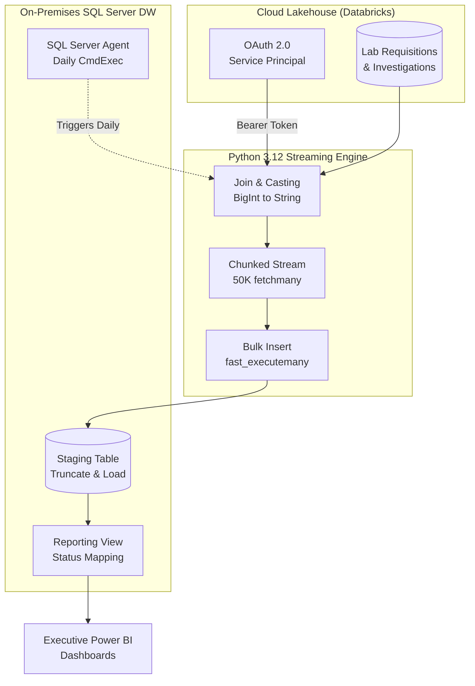

# Cloud Databricks to SQL Server ETL Pipeline

> **Enterprise Confidentiality Notice (NDA):** This repository presents the reference architecture and a fully sanitized implementation of a production healthcare data integration pipeline. All proprietary server hostnames, credentials, schema identifiers, and organization-specific names have been redacted and replaced with generic placeholders.

## 1. Project Objective & Context
An automated, end-to-end ETL pipeline designed to extract **1.45M+ clinical laboratory requisition records** from a cloud **Databricks Lakehouse** and load them into an on-premises **SQL Server** reporting warehouse powering executive **Power BI** dashboards.

The pipeline bridges historical granularity gaps between clinical investigation records and Laboratory Information System (LIS) reporting requirements, delivering clean, standardized datasets on a daily schedule.

## 2. System Architecture



## 3. Architecture & Engineering Highlights
- **Memory-Safe High-Volume Streaming:** Uses Python 3.12 with `50,000`-row chunked extraction (`fetchmany`) paired with `pyodbc` `fast_executemany` bulk inserts to process **1.45M+ records** with minimal memory footprint.
- **Secure OAuth 2.0 Authentication:** Authenticates against Databricks REST APIs using Service Principal (`client_credentials`) with environment-isolated configuration (`.env`).
- **Cross-Platform Schema & Encoding Resolution:**
  - Engineered `TRIM(CAST(... AS STRING))` join logic to resolve `BigInt`-to-`String` type mismatches and trailing whitespace that previously resulted in `NULL` investigation codes.
  - Standardized UTF-8 character handling and specimen ID trimming during ingestion.
- **Dynamic Date-Fallback & Input Validation:** Defaults to a full-year baseline (`YYYY-01-01`) for automated runs while supporting validated CLI date overrides (`ISO-8601`) for ad-hoc backfills.
- **Decoupled Presentation Layer:** Separates raw ingestion (`dbo.Staging_Lab_Requisitions`) from business reporting logic (`dbo.vw_Lab_Report`), mapping raw laboratory statuses into strict binary outputs (`received` / `not received`).
- **Zero-Touch Orchestration:** Automated daily via **SQL Server Agent** (`CmdExec` step) with structured execution logging.

## 4. Repository Structure
- `src/etl_pipeline.py` — Sanitized Python 3.12 OAuth + chunked streaming ETL script.
- `SQL/vw_lab_report.sql` — SQL Server presentation view and UAT validation query.
- `.env.example` — Environment variable template for secure credential isolation.
- `.gitignore` — Excludes sensitive `.env` credentials, virtual environments, and cache artifacts.
- `requirements.txt` — Python dependency manifest.

## 5. Quick Start (Reference Setup)
1. Install dependencies:
   ```bash
   pip install -r requirements.txt
   ```
2. Copy `.env.example` to `.env` and populate your Databricks and SQL Server connection settings.
3. Run the pipeline (defaults to `2026-01-01`, or pass a custom `YYYY-MM-DD` start date):
   ```bash
   python src/etl_pipeline.py
   # Or ad-hoc backfill:
   python src/etl_pipeline.py 2026-06-01
   ```
